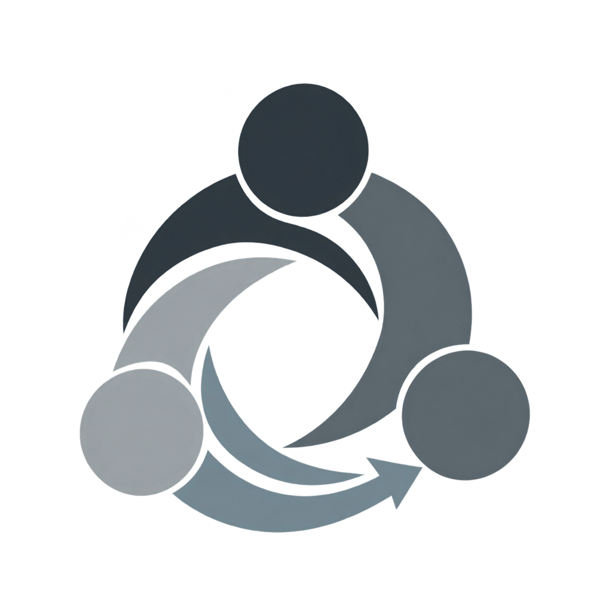
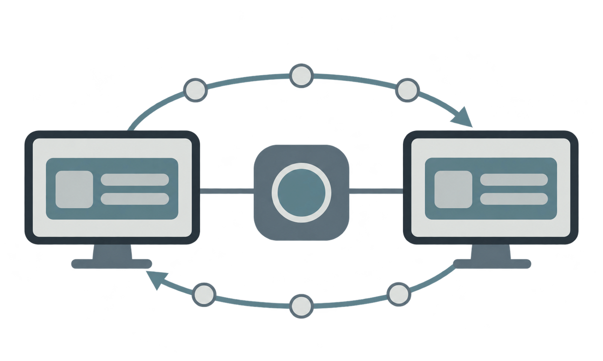

# Central

<p align="center">
  
</p>

Central is a Windows desktop workspace for collaborative software development.
It brings project context, coordination, shared-state boundaries, verification,
and review-led delivery into one public codebase.

The repository is intentionally honest about its phase. Implemented behavior,
local simulations, synchronized state, and planned integrations are documented
separately; a proposal is never presented as a production capability.

## Public scope

- .NET 8 and WPF desktop application in `app/`.
- Companion automation bot in `bot/`.
- Database migrations and access rules in `db/`.
- Gateway, installer, and operational scripts in `ops/`.
- Automated tests in `tests/`.
- Public architecture, decisions, development plan, and review rules in `docs/`.
- Versioned visual and bot assets in `assets/`.

## Repository map

| Path | Responsibility |
|---|---|
| `app/` | desktop application and shared core |
| `bot/` | companion automation bot |
| `db/` | database migrations |
| `ops/` | gateway, installer, and operational scripts |
| `tests/` | application and bot tests |
| `assets/docs/` | public documentation visuals |
| `assets/bot/` | runtime artwork used by the bot |
| `docs/` | public guides, decisions, integrations, and plans |
| `.github/` | CI and Pull Request templates |

## Documentation

Start with [`docs/README.md`](docs/README.md). It defines the reading order and
connects the architecture, build, test, integration, operations, and planning
documents.

- [`docs/guide/contribute.md`](docs/guide/contribute.md) — commit and Pull
  Request workflow.
- [`docs/guide/branches.md`](docs/guide/branches.md) — branch purposes and
  lifecycle.
- [`docs/guide/maintenance.md`](docs/guide/maintenance.md) — documentation and
  asset maintenance rules.
- [`docs/plan/`](docs/plan/) — public product and development planning.

## Development workflow

Plan first, create a branch from the latest `origin/main`, make a focused
change, run the relevant checks, commit it, push the branch, and request a Pull
Request. `main` is reserved for reviewed and approved changes.

Do not add credentials, tokens, private identifiers, local paths, runtime data,
or copied private conversations. Examples must use placeholders. See
[`AGENTS.md`](AGENTS.md) for the complete agent contract.

## Build and test

From PowerShell at the repository root:

```powershell
dotnet restore .\Central.sln
dotnet build .\Central.sln -c Release --no-restore
dotnet test .\Central.sln -c Release --no-restore
python -m pytest tests/peace -q
```

The bot test command requires the project's Python environment and dependencies.
The exact packaging flow is in [`docs/guide/build.md`](docs/guide/build.md).

## Coordination boundary



The visual above explains the intended relationship between local endpoints and
the coordination layer. It is a conceptual representation, not evidence that a
two-computer synchronization test has passed. Check the architecture and
decision records for the current implementation status and limitations.
