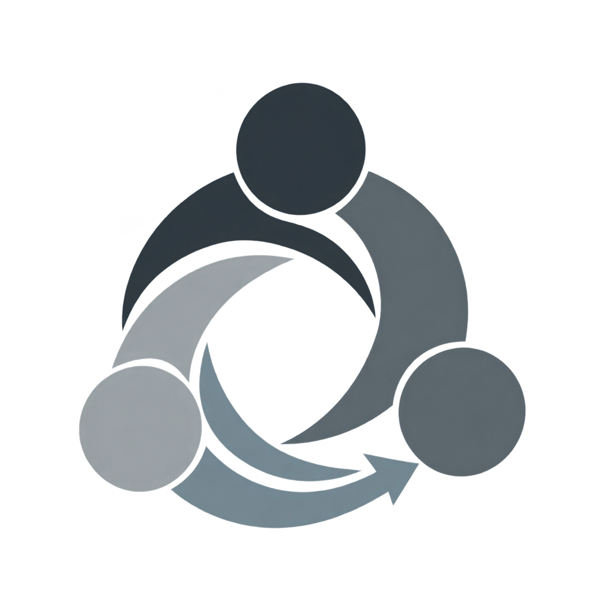
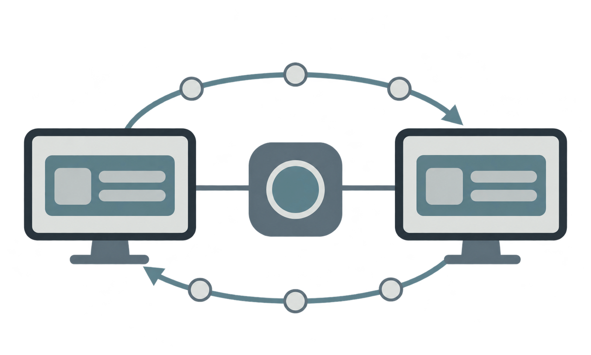
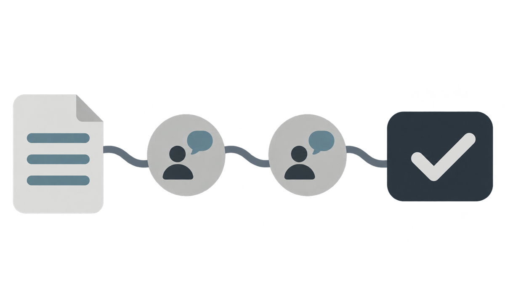

# Documentation map

  

This directory is the public source of truth for how Central is built,
verified, operated, and extended. The folders are organized by reader need and
responsibility, not by implementation history.

## Read in this order

1. [`../README.md`](../README.md) — public scope and quick start.
2. [`architecture/system.md`](architecture/system.md) — runtime boundaries and
   current limits.
3. [`guide/build.md`](guide/build.md) and [`guide/test.md`](guide/test.md) —
   reproducible development and verification.
4. [`guide/contribute.md`](guide/contribute.md) and
   [`guide/branches.md`](guide/branches.md) — commits, branches, Pull Requests,
   and review.
5. [`architecture/design.md`](architecture/design.md) and
   [`architecture/decisions/`](architecture/decisions/) — interface rules and
   recorded technical decisions.
6. [`integration/`](integration/) and [`operations/`](operations/) — public
   contracts and deployment boundaries.
7. [`guide/maintenance.md`](guide/maintenance.md) — documentation ownership and
   maintenance rules.
8. [`plan/`](plan/) — public product and development planning.

## Document groups

| Group | Location | Purpose |
|---|---|---|
| Guides | `guide/` | build, tests, branches, contribution, maintenance |
| Architecture | `architecture/` | runtime, design, server, and decisions |
| Integration | `integration/` | public contracts between components |
| Operations | `operations/` | deployment boundaries and smoke checks |
| Bot | `bot/` | companion bot behavior, operations, and source rules |
| Planning | `plan/` | product, security, roadmap, and acceptance planning |
| Template | `template/` | reusable project-delivery structure |

## Visual language

The visuals are used where they explain a relationship instead of decorating a
page. They contain no operational identifiers and are kept separate from bot
runtime artwork.

### Coordination

Use this visual with [`architecture/system.md`](architecture/system.md) when
explaining local endpoints, coordination state, and the boundary between data
movement and authoritative state.

### Review

Use this visual with [`guide/branches.md`](guide/branches.md) when explaining the
branch → commit → Pull Request → review → `main` path.

## Status language

Every document must make its status clear:

- **Implemented** — code exists and the cited verification can reproduce it.
- **Verified** — the implementation was exercised by the stated check or
  observation.
- **Planned** — the target is documented but not available yet.
- **Deferred** — intentionally postponed with a reason.
- **Unverified** — code or configuration exists, but the required proof is not
  complete.

Do not use a future-tense plan as evidence of a delivered feature.

## Public boundary

Planning is intentionally public so the team can work from the same source.
Public docs contain only repository-level contracts, reproducible commands,
decisions, and evidence that can be shared openly. Keep secrets, private
identifiers, local machine paths, member data, and live credentials out of this
directory. Use placeholders and link to committed examples instead.
