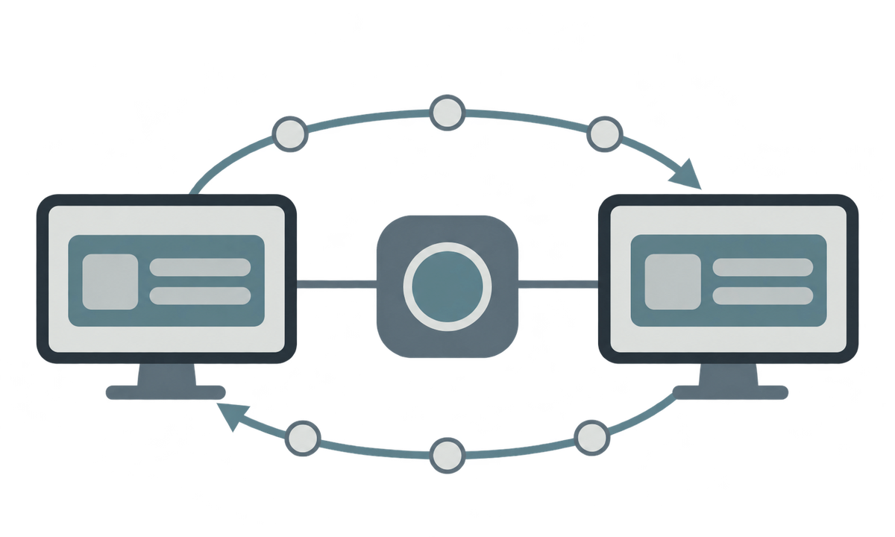

# Local delivery architecture

## Choice

The first phase uses a WPF desktop monolith on .NET 8. This is intentional:
the documentation recommends validating the coordination core first instead of
starting with microservices or a decorative dashboard. The application keeps a
separation between the shell, views, view model, domain models, and
`CentralStore`.

The operational increment adds `Central.Core` with reservations, leases, and
connectivity adapters. Collaboration between computers uses three separate
planes: Syncthing transports bytes; Supabase Auth/PostgreSQL/Realtime authorizes,
records state, and delivers notifications; PythonAnywhere provides health and
capabilities only. The in-memory coordinator and catalog fixtures are not shared
authority.

```text
MainWindow
  ├── DashboardView
  ├── ProjectsView
  ├── ProjectView
  ├── TeamView
  └── SettingsView

CentralViewModel
  └── CentralStore
        ├── Projects / Tasks / Claims simulated
        ├── Activity / Discussions
        ├── Deliveries / Quality checks
        └── Team / Agent sessions

CentralSyncRuntime
  ├── SyncthingRuntime + SyncthingClient (bytes, peers, pause, status)
  ├── SupabaseRestClient (Auth, RPCs, snapshot/replay, heartbeat)
  └── SupabaseRealtimeClient (private channel, presence, reconnect, replay)
```



This visual summarizes the boundary between local endpoints, byte transport,
and coordination state. It is explanatory only; the repository does not treat
the illustration as proof of a live two-computer session.

## Exercised rules

- The project is selected by a catalog record; a folder name is never used as the key.
- A task reservation has semantic conflict detection by logical area.
- A patch is accepted only for an open project and, when provided, the current base revision.
- Workspace revisions are monotonic and recoverable.
- Closing increments the local generation/fencing value and blocks writes, reservations, deliveries, and integration.
- A delivery candidate requires evidence, is not a deployment, and integrates only after approval.
- Activity events show observable facts, not private reasoning or invasive telemetry.

## Current state and limits

`CentralStore` remains the source for the visual screens and has not been
silently turned into a remote catalog. The synchronization vertical slice is
explicit and separate: it requires a Supabase session, a valid organization and
project, and a dedicated folder. The committed migration is the public schema
contract; external deployment state is intentionally not published here. An
observed two-PC proof, invites/members in the UI, and Git/CI/deploy integration
remain unverified until they are reproduced from a clean environment.
