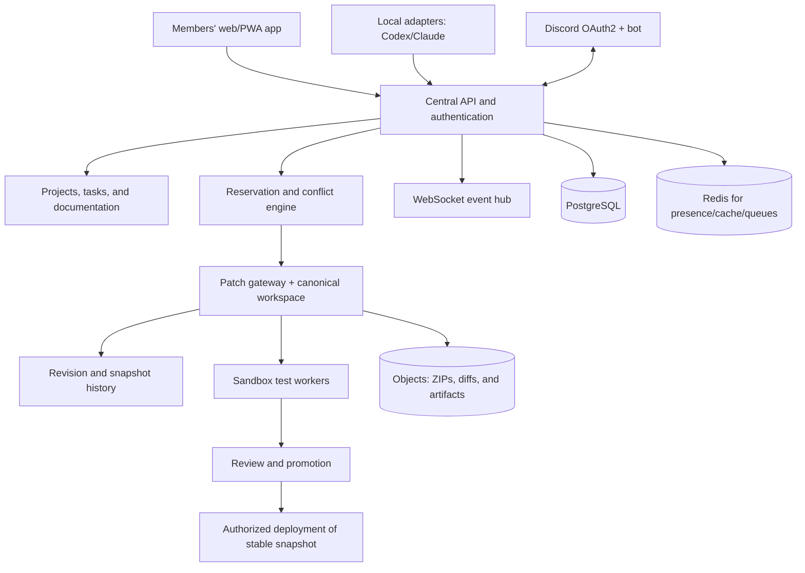

# 05 — Suggested technical architecture

## Guideline

Start as a **modular monolith**, not several microservices for fashion. Clearly
separate domains into modules with documented interfaces. Extract services only
when measurements or requirements show a need. The shared workspace and agent
execution deserve operational isolation early.

## Components

**PostgreSQL database:** people, permissions, project, requirements, tasks,
reservations, revisions, audit events, and decisions.
**Redis:** transient sessions, presence, and short-lived events, with important
events durably stored in the database.
**Object storage:** attachments, ZIPs, backups, and build artifacts, scoped by
project.
**Canonical workspace:** repository or versioned-content storage mutable only by
the gateway. If Git is used internally for snapshots, **one write queue per
repository** avoids concurrency in the Git index.

## Suggested stack — pragmatic option, not the only one

- Web: TypeScript with React/Next.js or equivalent, mobile-first; PWA first.
- Backend: TypeScript/Node (modular framework) **or** Python/FastAPI, according
  to proven team expertise. Do not mix stacks without a clear advantage.
- Persistence: PostgreSQL with migrations and transactions.
- Events: authenticated WebSocket + durable channel/queues for important
  notifications; SSE may serve read-only consumers.
- Jobs and sandbox: isolated ephemeral workers/containers for tests, builds, and previews.
- Source/versioning: Git as the snapshot/release trail, without requiring
  individual branches in the collaborative work interface.
- Infrastructure: Docker/containers, CI/CD, secret management, daily backup,
  and tested restore. Hosting depends on cost, compliance, disk/network performance.
- Metrics and logs: OpenTelemetry and compatible collection/visualization tools;
  reduce sensitive data.

## Boundary between coordination and agent integration

`task-service` decides assignment. `claim-service` decides area ownership.
`workspace-gateway` is the **only writer** to the canonical workspace and assigns
ordered revisions. `agent-adapters` do not write directly to the central
repository. `event-hub` reports activity after gateway confirmation.
`review-service` records decisions; `release-service` promotes a revision only
when requirements are met.

## Consistency guarantees

- For each project, serialize **patch application** or use an equivalent
  transactional protocol. Many agents may be concurrent, but confirming the
  canonical update has a defined order.
- Reservation, patch/snapshot validation, and revision assignment happen in the
  same consistency region and use transactions or compare-and-swap.
- `patch.apply` has an idempotency key and base revision. Repeating the same
  request after a timeout does not reapply the change.
- Sign or hash content and keep a verifiable revision chain; backups are
  independent of the live server.
- Reconnection obtains events from `last_seq`; if the log expired, rehydrate the
  current snapshot and resume from there.
- Events may be delivered at least once: consumers deduplicate by `event_id` and
  order by `project_seq`.

## Infrastructure and environments

1. **Development local:** artificial data and team tests.
2. **Staging/preview:** frozen revision for testing a release candidate; secrets and data segregated.
3. **Production:** approved, monitored, reversible snapshot.

Do not build the client's production directly on the file volume that AIs edit.

## Client isolation

Projects have `organization_id` and `project_id`; require a filter in queries and
authorization validation in every API. Client data must never enter another
project's global search. Repositories and buckets are logically or physically
segregated according to risk; databases become more isolated under future contracts.

## Evolutionary architecture

- Initial stage: central API process + database + websocket + single gateway;
  easy to inspect and debug.
- With volume: separate queues/workers, then workspace service if a measured bottleneck appears.
- With enterprise needs: advanced traceability, contractual retention, key
  management, organization policies, and stronger isolation.

## Documenter's decision diagram

The tree proposed by the documenter is **technical input**. The technical lead
reviews service and security boundaries; frontend and backend agree on contracts;
QA defines tests. Central turns the agreed modules and contracts into configured
ownership areas with folder/symbol mappings.
