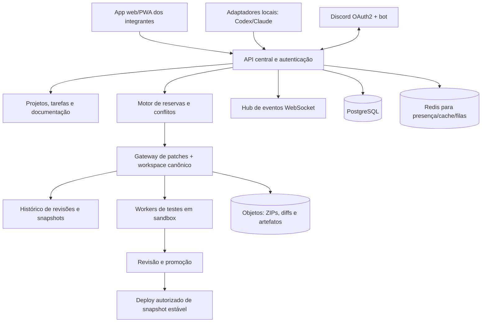

# 07 — Arquitetura técnica sugerida

## Diretriz

Começar como **monólito modular**, não vários microsserviços por moda. Separar claramente os domínios em módulos com interfaces documentadas. Só extrair serviços quando medições ou requisitos mostrarem necessidade. O workspace compartilhado e execução de agentes merecem isolamento operacional desde cedo.

## Componentes

**Banco PostgreSQL:** pessoas, permissões, projeto, requisitos, tarefas, reservas, revisões, eventos de auditoria, decisões.  
**Redis:** sessões transitórias, presença e eventos de baixa duração, com armazenamento durável dos eventos importantes no banco.  
**Armazenamento de objetos:** anexos, ZIPs, backups e artefatos de build, com controle de projeto.  
**Workspace canônico:** repositório ou armazenamento de conteúdo versionado, mutável somente pelo gateway. Se usar Git internamente para snapshots, **uma única fila de escrita por repositório** evita concorrência no índice do Git.

## Pilha sugerida — opção pragmática, não única

- Web: TypeScript com React/Next.js ou equivalente, mobile-first; PWA primeiro.
- Backend: TypeScript/Node (framework modular) **ou** Python/FastAPI, conforme domínio comprovado da equipe. Não misturar stacks sem vantagem clara.
- Persistência: PostgreSQL com migrações e transações.
- Eventos: WebSocket autenticado + canal durável/filas para notificações importantes; SSE pode servir a consumidores somente leitura.
- Jobs e sandbox: workers/containers efêmeros isolados para testes, build e prévia.
- Fonte/versionamento: Git como trilha de snapshots e releases, sem exigir branches individuais na interface de trabalho colaborativo.
- Infra: Docker/contêineres, CI/CD, gestão de segredos, backup diário e restore testado. Hospedagem dependerá de custo, compliance, desempenho de disco e rede.
- Métricas e logs: OpenTelemetry e ferramentas de coleta/visualização compatíveis; reduzir dados sensíveis.

## Limite entre coordenação e integração de agentes

`task-service` decide atribuição. `claim-service` decide posse de área. `workspace-gateway` é o **único escritor** do workspace canônico e atribui revisões ordenadas. `agent-adapters` não escrevem diretamente no repositório central. `event-hub` informa atividades depois da confirmação do gateway. `review-service` registra decisões; `release-service` só promove revisão com requisitos atendidos.

## Garantias de consistência

- Para cada projeto, serializar **aplicação de patches** ou usar protocolo transacional equivalente. Pode aceitar muitos agentes concorrentes, mas o passo de confirmar atualização canônica possui ordem definida.
- Reserva/validação do patch/snapshot e atribuição de revisão acontecem na mesma região de consistência e com transações ou mecanismo de compare-and-swap.
- `patch.apply` com idempotency key e revisão-base. Repetir a mesma solicitação após timeout não reaplica mudança.
- Assinar ou hashear conteúdo e manter cadeia verificável de revisões; backups independentes do servidor vivo.
- Reconexão obtém eventos a partir de `last_seq`; caso log expirado, reidrata snapshot atual e retoma dali.
- Eventos podem ser entregues pelo menos uma vez: consumidores deduplicam por `event_id` e ordenam por `project_seq`.

## Infra e ambientes

1. **Local de desenvolvimento:** dados artificiais e teste da equipe.
2. **Staging/preview:** revisão congelada para testar uma candidata a release; segredos e dados segregados.
3. **Produção:** snapshot aprovado, monitorado e reversível.

Não montar a produção do cliente diretamente sobre o volume de arquivos que as IAs editam.

## Isolamento por cliente

Projetos têm `organization_id` e `project_id`; exigir filtro em consultas e validação de autorização em todas as APIs. Dados de clientes jamais entram em busca global de outro projeto. Repositórios e buckets segregados logicamente ou fisicamente segundo risco; bancos mais isolados conforme contratos futuros.

## Arquitetura evolutiva

- Etapa inicial: processo API central + banco + websocket + gateway único; fácil inspecionar e depurar.
- Com volume: separar filas/workers, depois serviço de workspace, se gargalo medido.
- Com necessidade enterprise: rastreabilidade avançada, retenção contratual, gerenciamento de chaves, políticas por organização e isolamento reforçado.

## Diagrama das decisões do documentador

A árvore proposta pelo documentador é **insumo técnico**. Líder técnico revisa limites de serviço e segurança; frontend e backend concordam contratos; QA define testes. A central transforma os módulos e contratos acordados em áreas de posse configuradas, com mapeamento de pastas/símbolos.
